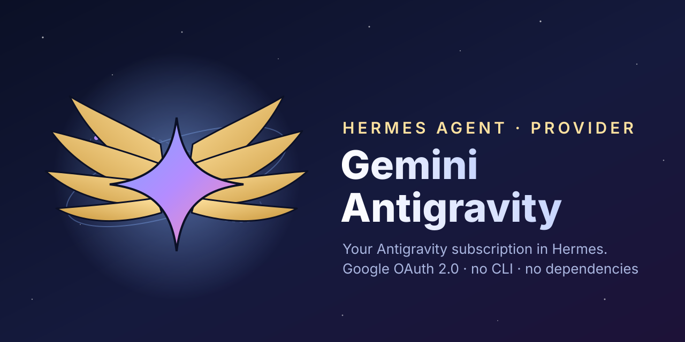

<p align="center"></p>

# Gemini Antigravity pour Hermes Agent

Faites tourner [Hermes Agent](https://github.com/NousResearch/hermes-agent) sur votre **abonnement Google Antigravity** (Gemini 3.8 Flash, Claude, GPT-OSS…, ce que Google propose à votre compte).

La connexion passe **directement par Google, en OAuth 2.0**. Ni CLI agy, ni processus en arrière-plan, ni paquet tiers : le plugin tient en trois fichiers Python qui n'utilisent que la bibliothèque standard et les modules de Hermes.

## Installer

```bash
npx hermes-gemini-antigravity
```

La commande copie le plugin dans `~/.hermes/plugins/gemini-antigravity` (Windows : `%LOCALAPPDATA%\hermes\plugins\gemini-antigravity`). Pour viser un autre dossier Hermes ou un autre profil, utilisez `--home <dossier>` ou `HERMES_HOME`. Installation possible aussi depuis Git :

```bash
hermes plugins install Battiatus/hermes-gemini-antigravity
```

## Se connecter

```bash
hermes auth add gemini-antigravity
```

Le navigateur ouvre la connexion Google. Hermes garde ensuite le compte dans son trousseau et renouvelle le jeton tout seul.

**Navigateur sur un autre appareil** (SSH, serveur, téléphone) : ouvrez le lien affiché où vous voulez et connectez-vous. Le navigateur finit sur une page `localhost:51121` qui ne s'affiche pas : copiez son adresse et collez-la dans le terminal.

Relancez la commande pour ajouter d'autres comptes. `hermes auth status gemini-antigravity` les liste, `hermes auth logout gemini-antigravity` les retire.

## Utiliser

```bash
hermes model        # fournisseur « Gemini Antigravity », puis un modèle
```

- **Modèles :** le sélecteur montre ce que Google propose à votre compte, dans l'ordre d'Antigravity. Un modèle par niveau de raisonnement (`…-low`, `…-medium`, `…-high`).
- **Quotas :** `/usage` affiche les fenêtres de 5 heures et hebdomadaires, comme dans Antigravity.
- **Outils, images et flux :** ils passent par la traduction Gemini native de Hermes. Les schémas d'outils de Claude partent en JSON Schema.
- **Session :** une session Hermes garde la même session Antigravity, ce qui permet à Google de réutiliser son cache.

## Réseaux

- **Proxy :** `HTTPS_PROXY`, `ALL_PROXY` et `NO_PROXY` sont respectés.
- **Fichier hosts :** s'il redirige `cloudcode-pa.googleapis.com` vers `127.0.0.1`, le plugin demande la vraie adresse au DNS public de Google. Rien à modifier sur la machine.
- **Systèmes :** Windows, Linux et macOS.

## Désinstaller

```bash
npx hermes-gemini-antigravity uninstall
hermes auth logout gemini-antigravity
```

## Licence

MIT
