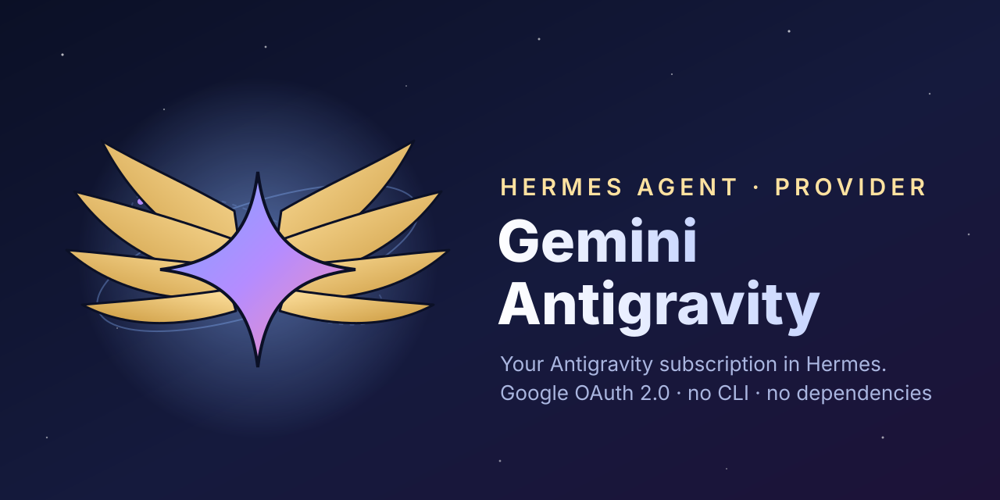

<p align="center"></p>

# Gemini Antigravity for Hermes Agent

Run [Hermes Agent](https://github.com/NousResearch/hermes-agent) on your **Google Antigravity subscription** (Gemini 3.8 Flash, Claude, GPT-OSS…, whatever Google offers your account).

Sign-in goes **straight to Google with OAuth 2.0**. You don't need the agy CLI, a background process or any third-party package. The plugin is three Python files that use only the standard library and Hermes' own modules.

[Français](README.fr.md)

## Install

```bash
npx hermes-gemini-antigravity
```

This copies the plugin into `~/.hermes/plugins/gemini-antigravity` (Windows: `%LOCALAPPDATA%\hermes\plugins\gemini-antigravity`). Pass `--home <dir>` or set `HERMES_HOME` to target another Hermes home or profile. You can also install it from Git:

```bash
hermes plugins install Battiatus/hermes-gemini-antigravity --force
```

`--force` is needed because Hermes' plugin scanner flags one line, `antigravity.py:29`: the Antigravity app's OAuth client secret (`GOCSPX-…`). It is a Google installed-app secret, public by design and shipped in every copy of Antigravity, so Hermes rates it "caution", not "dangerous". It still blocks community plugins at that level unless you confirm. The `npx` install above copies the files directly and does not ask.

## Sign in

```bash
hermes auth add gemini-antigravity
```

Your browser opens Google's sign-in page. Afterwards, Hermes stores the account in its credential pool and refreshes the token by itself.

**Browser on another device** (SSH, server, phone): open the printed link anywhere and sign in. The browser then lands on a `localhost:51121` page that does not load. Copy that page's address and paste it into the terminal.

Run the command again to add more accounts. Use `hermes auth status gemini-antigravity` to see them and `hermes auth logout gemini-antigravity` to remove them.

## Use

```bash
hermes model        # provider "Gemini Antigravity", then a model
hermes -m gemini-3.8-flash-high --provider gemini-antigravity
```

- **Models.** The picker lists what Google offers your account, in Antigravity's order. Google publishes one model per reasoning level (`…-low`, `…-medium`, `…-high`), so the level is part of the model id.
- **Quotas.** `/usage` shows the 5-hour and weekly windows of each model group, as in Antigravity.
- **Tools, images and streaming** go through Hermes' native Gemini translation. Claude models get their tool schemas as plain JSON Schema.
- **Session cache.** A Hermes session keeps one Antigravity session, so Google can reuse its prompt cache.

## Networks

- **Proxies.** `HTTPS_PROXY`, `ALL_PROXY` and `NO_PROXY` are honoured.
- **Redirected hosts.** Some tools leave hosts-file entries that send `cloudcode-pa.googleapis.com` to `127.0.0.1`. In that case the plugin asks Google's public DNS for the real address. You don't need to change your hosts file or flush DNS.
- Works on Windows, Linux and macOS.

## How it differs from the agy-based plugins

The other Antigravity providers in the Hermes catalog run Google's agy CLI and borrow its login. This one talks to the same Google endpoints the Antigravity client uses (`v1internal`), with the same OAuth client. As a result:

- there is no agy install, no subprocess and no temporary HOME;
- several accounts sit in Hermes' credential pool, with automatic refresh and rotation;
- Hermes' own tools run unchanged.

## Uninstall

```bash
npx hermes-gemini-antigravity uninstall
hermes auth logout gemini-antigravity
```

## Disclosure

Inference and `/usage` reads count against the Antigravity subscription of the account you sign in with. Tokens are stored only in Hermes' `auth.json`. Requests go only to Google: `accounts.google.com`, `oauth2.googleapis.com`, `www.googleapis.com` (account email), `*cloudcode-pa.googleapis.com`, and `dns.google` (8.8.8.8), which is asked only when the hosts file redirects an Antigravity host.

## License

MIT
